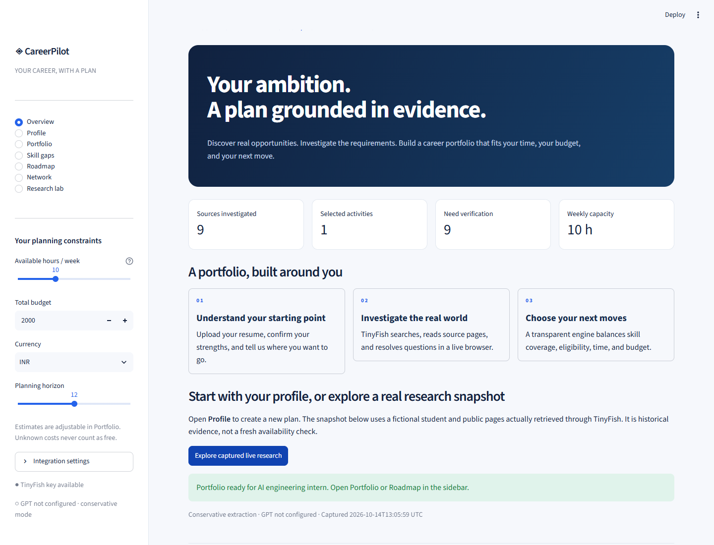
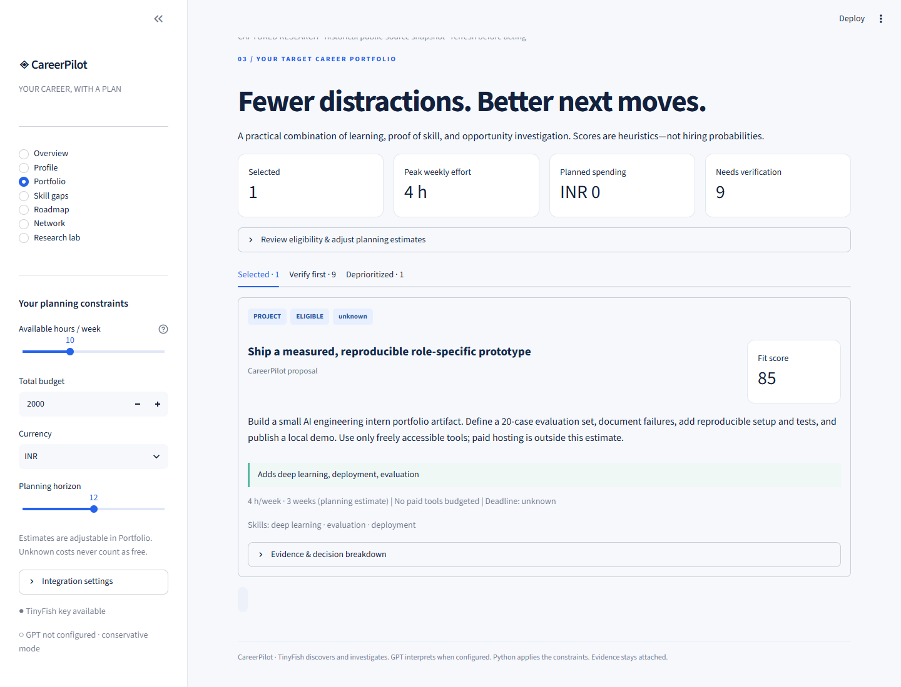
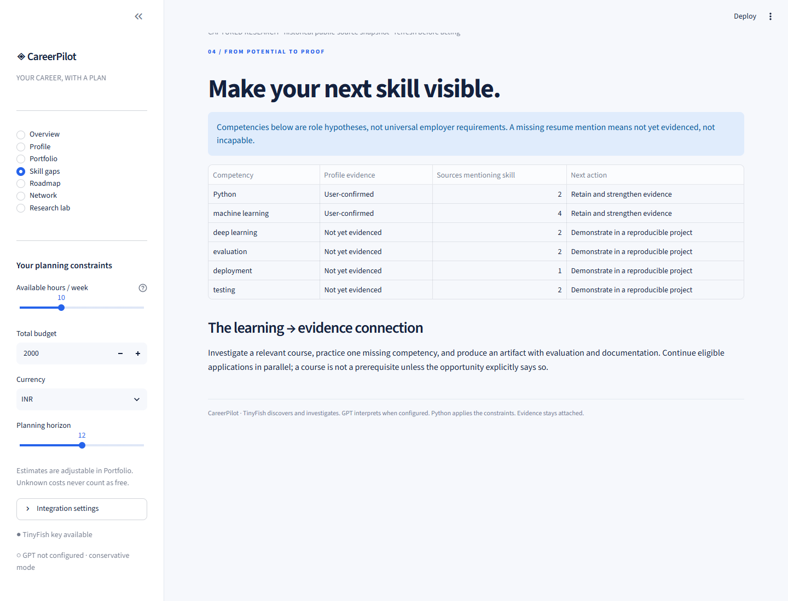
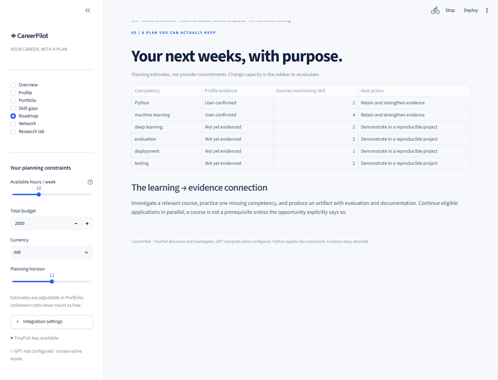
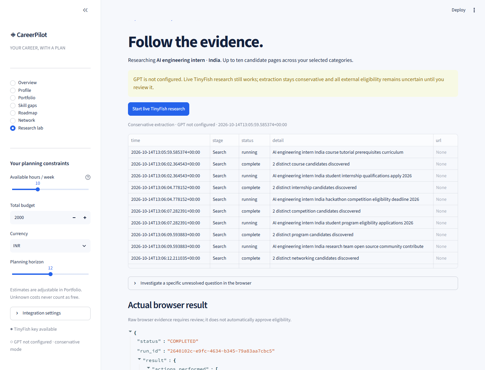
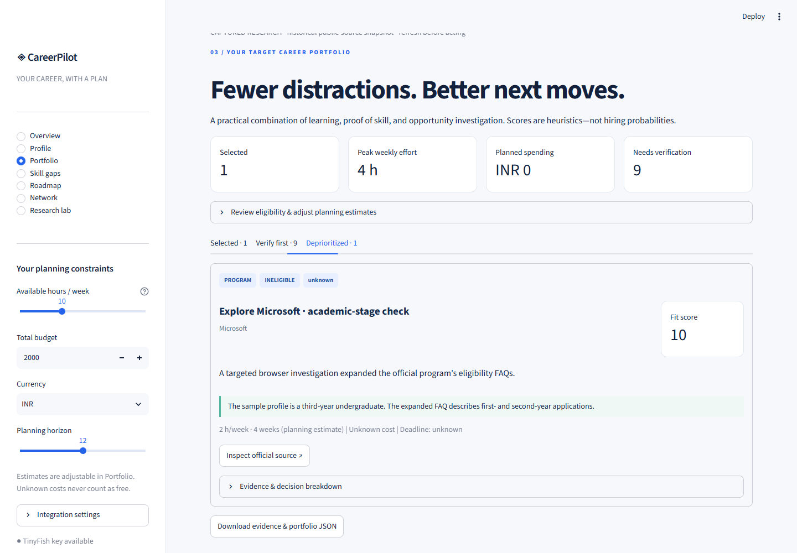
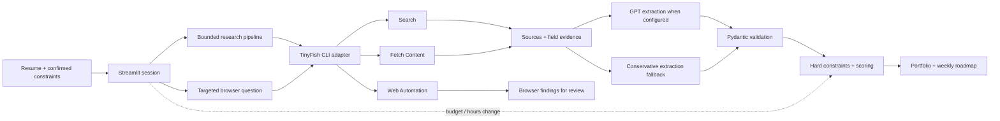

<div align="center">

# ◈ CareerPilot

### Your ambition. A plan grounded in evidence.

**A TinyFish-powered career portfolio advisor that investigates opportunities, explains uncertainty, and fits your next moves to your actual capacity.**


[Quick start](#quick-start) · [Screenshots](#the-real-product) · [TinyFish integration](#where-tinyfish-does-the-work) · [Live validation](#what-was-actually-tested) · [Limitations](#honest-boundaries)

</div>



> **Implementation status:** The app runs locally. TinyFish Search and Fetch were tested through the Python application adapter; a real browser run expanded Microsoft's eligibility FAQs. The bundled demo contains nine fetched pages and the browser result. GPT support is implemented but **was not live-tested because OpenAI credentials were unavailable**. The screenshots show the working conservative mode.

## The problem

A student does not need another hundred links. They need to know which activities deserve their limited time—and which opportunities are unsuitable, uncertain, or redundant.

CareerPilot turns a resume and a target role into a research workspace and a practical portfolio. Source evidence stays attached to the advice. Eligibility failures remain failures, even when an opportunity looks attractive.

### The student journey

**Resume → confirmed profile → public research → evidence review → feasible portfolio → weekly roadmap**

| Student question | CareerPilot's response | What makes it inspectable |
|---|---|---|
| What should I work toward? | Role competencies and skills not yet evidenced | User-confirmed skills separated from role hypotheses |
| What opportunities are relevant? | Courses, internships, competitions, programs, and networking sources | Actual TinyFish retrievals with URLs and timestamps |
| Can I apply? | Eligible, uncertain, or ineligible | Explicit reasons; unknown conditions stay unresolved |
| Can I afford this? | A budget-aware selection and a conditional queue | Unknown fees never silently become zero |
| What fits into my week? | Scheduled activities within weekly capacity | Change the hours slider and selection recalculates |
| Why this recommendation? | Score components, source excerpts, and selection reasons | An evidence drawer on each card |

## The real product

All images below are **screenshots of the actual local Streamlit application**, captured with headless Microsoft Edge. No generated mockups, fabricated tool feeds, or imaginary employer openings are used.

The demo profile is fictional. Public research is a dated snapshot and must be refreshed before acting.

### A portfolio with explicit uncertainty



The conservative demo deliberately selects a self-directed project and keeps external candidates in the verification queue. A source being fetched is not enough to approve someone's eligibility.

<table>
<tr>
<td width="50%"><strong>Skills → evidence</strong><br></td>
<td width="50%"><strong>Capacity → roadmap</strong><br></td>
</tr>
</table>

<details>
<summary><strong>Open the research workspace screenshot</strong></summary>



</details>

## Where TinyFish does the work

TinyFish is the application's research execution layer. Locally the Python process invokes the installed CLI. The Vercel entry point uses a direct HTTP transport whose endpoints and authentication were verified against the installed official `@tiny-fish/sdk`; no Node CLI is required in the cloud. The dashboard does not depend on a coding assistant being present.

| Stage | Real capability | Implemented behavior | Evidence returned |
|---|---|---|---|
| **Discover** | `tinyfish search query` | Category-specific searches using role, location, selected categories, and applicable graduation/gap hints | Candidate titles and URLs |
| **Investigate** | `tinyfish fetch content get` | Batch retrieval of promising pages with outbound links | Rendered page text, source URLs, supported excerpts |
| **Resolve** | `tinyfish agent run --sync` | User-selected, narrowly described interaction on a previously retrieved page | Actual actions, findings, blockers, and run metadata |
| **Recover** | `tinyfish agent run get/list` | Inspect an unresolved run before launching another | Run state and results |

### A real browser decision

The validation run visited [Explore Microsoft](https://careers.microsoft.com/v2/global/en/exploremicrosoft) and expanded two FAQs: the program's locations and which academic-year application to use.

That evidence exposed a meaningful mismatch: the fictional student is in their third year, while the investigated FAQ described first- and second-year applications. The demo records this as **ineligible**, with the supporting source excerpt attached. A promising brand name does not override a mandatory condition.



| Browser validation | Recorded result |
|---|---|
| Run ID | `2640102c-e9fc-4634-b345-79a83aa7cbc5` |
| Outcome | `COMPLETED`, with nonempty findings and no reported blocker |
| Actual interactions | Expanded two named FAQ sections |
| Tool steps | 10, as reported by TinyFish |
| Finished | 2026-10-14 13:08:21 UTC |
| Account limitation discovered | Custom `--max-steps` was rejected before execution; the successful run omitted the gated option |

Browser output is shown for review. The current MVP does not automatically treat arbitrary browser output as approved structured eligibility facts. The bundled academic-stage decision was manually reviewed against the real run result.

### Runtime architecture



**Boundary:** TinyFish discovers and retrieves. GPT interprets supplied evidence when configured. Python applies the decision rules. The UI exposes the results and the missing information.

## How decisions work

### 1. Hard constraints come first

Known eligibility failures, closed windows, graduation mismatches, and known location restrictions are handled before selection. Missing prerequisites remain uncertain. External opportunities with unresolved admission criteria require review.

### 2. A transparent score—not an employment prediction

| Component | Weight | Interpretation |
|---|---:|---|
| Career relevance | 25% | Coverage of the target-role competency hypothesis |
| Skill-gap reduction | 25% | Coverage of skills not yet evidenced in the profile |
| Eligibility fit | 20% | Eligible / uncertain ranking convention; ineligible items cannot be selected |
| Time efficiency | 10% | Relevant effort preference using editable planning estimates |
| Feasibility | 10% | Known affordability and weekly capacity |
| Deadline readiness | 10% | Urgency only when enough preparation time remains |
| **Total** | **100%** | **A configurable heuristic, never a hiring probability** |

Weights live in [`config/scoring.json`](config/scoring.json). The UI displays each component.

### 3. A small, explainable portfolio

The current selector uses a score-ordered greedy pass, checks each week's capacity, limits total spending, and suppresses courses with substantial skill overlap. It explains which skills an activity adds or reinforces.

It is **not a globally optimal solver**. Dependency graphs, fixed-event calendars, remaining effort on existing commitments, and marginal-value re-ranking are future improvements.

| Condition | Outcome |
|---|---|
| Mandatory eligibility failure | Deprioritized with reason |
| Unknown mandatory condition | Verify first |
| Unknown cost | Verify first |
| Nonzero cost in another currency | Verify first; no invented exchange rate |
| Exceeds remaining budget | Deprioritized |
| Cannot fit weekly capacity/horizon | Deprioritized |
| Substantially duplicates a selected course | Deprioritized |
| Fits constraints | Selected and assigned a planning window |

## Design comparison

This table compares product approaches, not audited competitor implementations.

| Dimension | Link-directory approach | General advice chat approach | CareerPilot MVP |
|---|---|---|---|
| Primary output | Listings | Narrative recommendations | Evidence workspace + constrained portfolio |
| Research mechanism | Indexed pages | Depends on tools provided | Explicit TinyFish Search / Fetch / Browser |
| Uncertainty | Often left to the reader | Depends on prompting | Dedicated conditional queue and missing fields |
| Capacity planning | Usually external | Usually described in prose | Deterministic weekly-capacity checks |
| Source inspection | Visit each listing | Depends on citation quality | Field excerpts, URLs, timestamps, and raw browser result |
| Constraint changes | Refilter listings | Ask another question | Recalculate selection without repeating research |
| Eligibility failure | Reader assessment | Model-dependent | Hard exclusion before selection |
| Missing credentials | Implementation-dependent | Service-dependent | Explicit status; conservative research mode remains usable |

## Quick start

### Prerequisites

- Python 3.12 recommended; tested with Python 3.12.10 on Windows.
- A working TinyFish CLI on `PATH`; tested with **0.50.1**.
- `TINYFISH_API_KEY` for fresh research.
- Optional OpenAI API key and an accessible model for GPT extraction.

The captured snapshot can be explored without either API credential.

### Windows / PowerShell

```powershell
python -m venv .venv
.\.venv\Scripts\python.exe -m pip install -r requirements.txt
Copy-Item .env.example .env
# Edit .env locally. Never commit real credentials.
.\.venv\Scripts\python.exe -m streamlit run app.py
```

Open **http://localhost:8501**.

### macOS / Linux

```bash
python3 -m venv .venv
.venv/bin/python -m pip install -r requirements.txt
cp .env.example .env
# Edit .env locally.
.venv/bin/python -m streamlit run app.py
```

### Environment

| Variable | Required? | Purpose |
|---|---|---|
| `TINYFISH_API_KEY` | For fresh research | Inherited by the CLI subprocess; never included in browser goals |
| `OPENAI_API_KEY` | For GPT features | Resume analysis and source interpretation |
| `OPENAI_MODEL` | Alongside OpenAI key | A model accessible to your API project |
| `TINYFISH_CLI_JS` | Only if automatic Windows resolution fails | Absolute installed TinyFish `dist/index.js` path |

Keys can also be entered in the sidebar's password fields for the current session. A ChatGPT/Codex sign-in is not an application API key. No default model availability is assumed.

The project deliberately does not invent a TinyFish installation command. Install the vendor CLI through your supported setup, then confirm `tinyfish --version` and `tinyfish search --help`.

### First session

1. Open **Profile** and upload a PDF/DOCX, or edit the manual fields.
2. Confirm the profile. Review detected skills rather than accepting mentions as proficiency.
3. Set available hours, total budget, currency, and horizon in the sidebar.
4. Open **Research lab → Start live TinyFish research**.
5. Review sources and use the browser only for a concrete unanswered interaction.
6. Open **Portfolio**, inspect evidence, and review uncertain conditions.
7. Reduce the hours slider to see selection change, then inspect **Roadmap**.

### Resume extraction: your document, not the demo profile

New profiles start blank. PDF/DOCX text is read from the uploaded file. The local parser extracts the resume's own skills sections without a fixed technology whitelist, plus education, explicit graduation dates, projects, experience, certifications, and achievements. Source excerpts are available beside the editable profile. Missing information stays blank.

With GPT credentials configured, **Read resume** also performs structured GPT extraction and checks returned evidence against the actual document. Unsupported claims are discarded; inferred skills stay separate. Uploading a different resume clears prior resume facts and invalidates the old research report. The fictional student is loaded only through the explicitly labeled snapshot button.

### Vercel deployment

`server.py` mounts the unchanged Streamlit UI through Streamlit 1.65's ASGI interface and FastAPI. `pyproject.toml` selects this entry point, and `vercel.json` configures the Python function. Local environments, credentials, runtime logs, and caches are excluded by `.vercelignore`.

```powershell
npx --yes vercel@latest login
npx --yes vercel@latest link --yes --project careerpilot
npx --yes vercel@latest deploy --prod --yes
```

Vercel's WebSocket support is in public beta and function connections have a finite lifetime. Session state is in memory; refreshes or instance changes can require re-uploading a resume. Hosted uploads are limited to 4 MB. Explore the captured snapshot without credentials, or enter your API credentials in the session's Integration settings for fresh research.

References: [Vercel Python runtime](https://vercel.com/docs/functions/runtimes/python), [WebSocket support and connection lifetime](https://vercel.com/kb/guide/do-vercel-serverless-functions-support-websocket-connections).

## What was actually tested

Validation performed on **2026-10-14**. Current opportunity availability must be checked again before acting.

| Capability | Validation | Result |
|---|---|---|
| PDF and DOCX extraction | Generated fictional sample files; parser tests | Passed |
| Real browser upload flow | Uploaded sample PDF, extracted skills, confirmed and saved profile | Passed |
| TinyFish Search | Five category searches from `scripts/live_smoke.py` through the Python adapter | Passed |
| TinyFish Fetch | Two batches; nine public source pages retrieved | Passed with one recorded unreachable source |
| Browser automation | Expanded official Microsoft FAQ sections | Completed with usable evidence |
| Decision logic | Eligibility, dates, capacity, budget, currencies, overlap, unsafe URLs | Passed |
| Dashboard | Streamlit AppTest navigation and constraint recalculation | Passed |
| Real screenshots | Headless Edge against the running local app | Seven captured screenshots |
| GPT resume / source extraction | Code integrated; no OpenAI key available | **Not live-tested** |
| Automatic application / outreach | Intentionally absent | Not performed |

Latest test run: **39 passed**, including the actual research-button invocation, blank-profile behavior, arbitrary resume skills, document replacement, evidence validation, and hosted HTTP transport. A real-browser regression also uploaded two different resumes and verified that their skills, education, projects, and graduation fields do not leak between documents. Synthetic unit-test activities are not used as real opportunities.

### Reproduce validation

```powershell
.\.venv\Scripts\python.exe -m pip install -r requirements-dev.txt
.\.venv\Scripts\python.exe scripts/make_samples.py
.\.venv\Scripts\python.exe -m pytest -q

# Performs real public research and replaces the bundled demo snapshot:
.\.venv\Scripts\python.exe scripts/live_smoke.py

# With the app already running; uses installed Microsoft Edge:
.\.venv\Scripts\python.exe scripts/capture_screenshots.py
.\.venv\Scripts\python.exe scripts/ui_smoke.py
```

[`requirements-lock.txt`](requirements-lock.txt) records the complete environment used for validation, including development dependencies. [`requirements.txt`](requirements.txt) contains the smaller runtime dependency set.

## Curated source map

These are configurable discovery targets, not guarantees that every page is accessible or every program is open.

| Area | Starting sources | Intended evidence |
|---|---|---|
| Learning | Hugging Face, Microsoft Learn, Google Developers, NPTEL | Curriculum and prerequisite clues |
| Internships | Microsoft Careers, Google Careers, Amazon Jobs | Role requirements and application information |
| Competitions | Devpost, Unstop, MLH | Event dates and participation rules |
| Programs | Google Summer of Code, GitHub Education, Linux Foundation LFX | Current cycle and eligibility |
| Networking | Public GitHub, Hugging Face, Microsoft research pages | Public work, teams, and communities |

Registry: [`config/sources.json`](config/sources.json). Search hits can include broad landing pages or third-party summaries; inspect the source before treating a candidate as authoritative. The conservative pipeline does not automatically elevate such pages into verified openings.

## Privacy and reliability

- Uploaded resumes are processed in the Streamlit session; the app does not intentionally write them to disk.
- GPT receives resume text only when configured and the user requests analysis.
- Search queries use broad role and constraint attributes rather than resume contact details.
- Credentials stay in environment variables or password inputs and are excluded from exported reports.
- The CLI bridge uses argument arrays with `shell=False`.
- Literal private addresses, local hostnames, non-HTTP(S) URLs, and credential-bearing URLs are rejected. DNS rebinding and remote redirects are not fully controlled by this local validator.
- Website content is treated as untrusted input. No site content can authorize applications, messages, purchases, or accounts.
- Unknown costs, dates, and eligibility remain unknown.
- A timed-out browser request may still be running. The UI prevents immediate duplicate starts and provides run inspection.
- Public demo research is stored intentionally for reproducible screenshots. Personal research is session-based unless the user exports it.

## Honest boundaries

| Current limitation | What the app does today |
|---|---|
| GPT credentials absent during validation | Explicit conservative mode; GPT path remains unverified live |
| No OCR | Scanned or unreadable resumes fall back to manual entry |
| No autonomous eligibility adjudication | Unknown conditions need review; explicit structured failures are enforced |
| Broad discovery can return weak candidates | Shows source evidence and uncertainty instead of claiming a verified vacancy |
| Role competency library is heuristic | Clearly labeled as hypotheses, not universal employer requirements |
| Effort estimates are approximate | Editable hours; provider commitments are not invented |
| Simple scheduler | Capacity and budget checks, without full prerequisite graphs or calendar integration |
| Networking is source-first | Suggestions tied to retrieved public pages; no inferred relationships or automatic messages |
| Browser findings are unstructured evidence | Shown verbatim for review; no automatic trust promotion |
| No persistent accounts or recurring monitors | Keeps the MVP focused and avoids unsolicited external actions |

## Repository guide

```text
app.py                         Streamlit workspace and session state
careerpilot/
  models.py                    Validated profiles, facts, opportunities, reports
  resume_parser.py             In-memory PDF/DOCX parsing and explicit mentions
  tinyfish_client.py           Real CLI subprocess adapter + URL checks
  llm.py                       Optional GPT Responses integration
  research.py                  Discovery, fetching, extraction, provenance
  engine.py                    Constraints, heuristic scoring, selection
config/
  sources.json                 Curated domain registry
  scoring.json                 Transparent score weights
samples/
  sample_resume.pdf/.docx       Fictional student profile
  live_report.json             Captured public research and real browser result
scripts/
  live_smoke.py                Explicit opt-in integration verification
  make_samples.py              Reproducible sample resume creation
  capture_screenshots.py        Real local-browser screenshots
  ui_smoke.py                   Actual upload and eligibility-view browser test
  attach_browser_evidence.py   Attach the actual recorded validation run
tests/                         Decision, parsing, safety, and UI checks
docs/screenshots/              Seven screenshots from the running app
```

## Three-minute demo

| Time | Show | Explain |
|---|---|---|
| 0:00–0:30 | Overview → load captured research | The student is fictional; source retrievals and browser execution are real |
| 0:30–1:00 | Research lab → actual browser result | TinyFish expanded specific eligibility FAQs, rather than generating advice from memory |
| 1:00–1:30 | Portfolio → Deprioritized | The Microsoft academic-stage mismatch cannot be rescued by a high score |
| 1:30–2:00 | Portfolio → Verify first | Unknown costs and mandatory conditions remain visible |
| 2:00–2:30 | Reduce weekly hours below four | The planned project leaves the feasible selection; no new research is required |
| 2:30–3:00 | Restore capacity → Roadmap | Show how selected work fits the student's actual week |

<div align="center">

**Research the opportunity. Keep the evidence. Choose the next move.**

</div>
